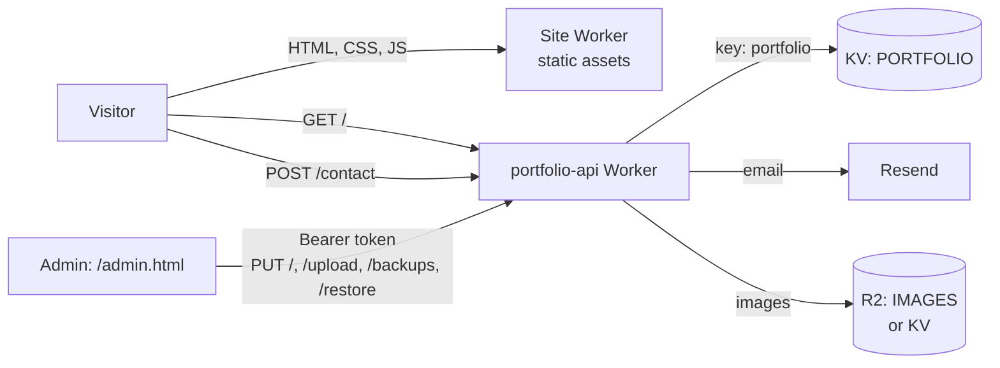

# Esraa Ehab · Dynamic Portfolio

A personal portfolio for an Android / Kotlin Multiplatform developer. The site is plain HTML, CSS and JavaScript (ES modules, no framework, no build step). **All content lives in one JSON document stored on Cloudflare**, and an admin dashboard edits it, so nothing is hard-coded in the pages.


- Public site: static files served by a Cloudflare Worker (static assets)
- API: a second Cloudflare Worker (`portfolio-api`) that stores the JSON in KV, handles the contact form (Resend) and image uploads
- Live site: https://dynamic-portfolio.esraaehabb333.workers.dev
- Admin: `/admin.html`, protected by an admin token
---

## Table of contents

1. [Features](#features)
2. [Tech stack](#tech-stack)
3. [Architecture](#architecture)
4. [Project structure](#project-structure)
5. [Data model](#data-model)
6. [How the public site works](#how-the-public-site-works)
7. [Project details page](#project-details-page)
8. [Admin dashboard](#admin-dashboard)
9. [API (Worker)](#api-worker)
10. [Local development](#local-development)
11. [Deployment](#deployment)
12. [Security](#security)
13. [Images, video and CV](#images-video-and-cv)
14. [Customizing](#customizing)
15. [Troubleshooting](#troubleshooting)
16. [Roadmap](#roadmap)

---

## Features

**Public site**
- Sections: Hero, About, Projects, Experience, Skills, Services, Education, Certifications, Contact, Footer
- Every text, image, link and color comes from the data; empty sections hide themselves
- Section order and visibility are set from the admin
- Dark and light theme (remembers the visitor's choice), custom accent colors
- Projects grid with "show more", and a full **project details page** at `#/project/<id>`
- Skills grouped by category (Languages, UI, Architecture, Data & Network, Testing & Tools, Other)
- Contact section with copy buttons and a ready-made email message (subject and body editable from the admin)
- Contact form with a status modal, a honeypot field and server-side validation
- Premium loader, custom cursor, reveal animations, particles (disabled on touch devices and for reduced motion)

**Project details page**
- Hero with logo, slogan, platform, status and download buttons (GitHub, Google Play, App Store, APK, live demo)
- Click-to-play demo video inside a phone frame (YouTube, Vimeo, Google Drive, `.mp4`/`.webm`)
- Facts strip, key features, screens gallery with lightbox, tech stack, architecture, challenges and lessons, local setup (copy button), collaborators, previous/next navigation
- Every part is optional; empty parts are not rendered

**Admin dashboard**
- Edit every section from forms, show/hide sections, reorder sections
- Image upload with in-browser compression (WebP), previews, and a data-size meter
- Project editor with tabs, chip inputs and a multi-image gallery
- Backups and restore (server side)

**API**
- Public read, protected write, automatic backup before every write, rate limits, escaped contact emails

---

## Tech stack

| Part | Technology |
|---|---|
| Front end | HTML5, CSS3 (custom properties, modular files), JavaScript ES modules |
| Icons | [Phosphor Icons](https://phosphoricons.com/) (web font) |
| Font | Inter (Google Fonts) |
| Hosting (site) | Cloudflare Workers with static assets (`wrangler.jsonc`) |
| API | Cloudflare Worker, KV (data, backups, rate-limit counters), optional R2 (images) |
| Email | [Resend](https://resend.com/) |
| Tooling | Wrangler CLI |

No frameworks, no bundler, no npm dependencies in the site itself.

---

## Architecture



1. The site loads, fetches the portfolio JSON from the API, and renders each section from it.
2. The admin loads the same JSON, edits it in memory, and saves it back with the admin token.
3. The API keeps the last 20 versions as backups.

---

## Project structure

```text
dynamic-portfolio/
├── wrangler.jsonc              # site Worker: serves ./portfolio as static assets
├── src/index.js                # ⚠ an API draft bundled with the site (see "Known issues")
├── tests/xss.html              # open in a browser: checks that admin data is escaped
├── .gitignore
└── portfolio/                  # the website (everything public)
    ├── index.html              # shell with a mount point for every section
    ├── project.html            # share-link redirect to index.html#/project/<id>
    ├── admin.html              # admin dashboard (login + forms)
    ├── contact-footer.css      # contact rows, hero icons, footer
    ├── _headers                # security headers (CSP, nosniff, noindex for admin)
    ├── css/
    │   ├── main.css
    │   ├── base/               # variables, reset, typography, layout
    │   ├── components/         # buttons, cards, forms, modals, timeline
    │   ├── effects/            # loader, cursor, particles, reveal
    │   ├── sections/           # one file per section
    │   └── project-page.css    # project details page (classes start with pp-)
    └── js/
        ├── main.js             # bootstrap: load data, render, init effects
        ├── config.js           # API_URL (the only setting)
        ├── theme-init.js       # applies dark/light before first paint (no flash)
        ├── project-page.js     # project details page + hash router
        ├── core/               # api.js, theme.js, utils.js, contact-links.js
        ├── effects/            # loader, cursor, magnetic, particles, reveal
        ├── sections/           # index.js + navbar, hero, about, projects, experience,
        │                       # skills, services, education, certifications, contact, footer
        └── admin/
            ├── admin-main.js   # dashboard controller (load, save, backups, section order)
            ├── auth.js         # token login (sessionStorage `admin_token`)
            ├── sections/       # site, hero, about, projects (+ project-fields), experience,
            │                   # skills, services, education, certifications, contacts
            └── shared/         # collection list, modal, image-field (upload), nav, toast
```

The API Worker (`portfolio-api`) is deployed separately on Cloudflare. Keep its source in the repo
under `worker/` (see [Deployment](#deployment)).

---

## Data model

The whole portfolio is **one JSON object** stored under the KV key `portfolio`.

| Key | Type | Fields |
|---|---|---|
| `site` | object | `logo`, `accent`, `secondary`, `theme` (`light`/`dark`), `tagline` |
| `hero` | object | `name` (eyebrow), `title` (headline, one `<span>` marks the gradient part), `description`, `image`, `cv_url`, `proof`, `textSize`, `eyebrowSize`, `titleSize`, `descriptionSize` |
| `about` | object | `label`, `title`, `bio`, `showStats`, `stats[]` = `{ title, subtitle, icon }` |
| `contact` | object | `title`, `subtitle`, `availability`, `response`, `emailSubject`, `emailBody` |
| `contacts` | array | `{ id, icon, label, value, url }` (labels Email, GitHub, LinkedIn, Phone are recognized) |
| `projects` | array | see below |
| `skills` | array | `{ id, name, category, image? }` |
| `services` | array | `{ id, title, subtitle, icon, image? }` |
| `experience` | array | `{ id, date, title, subtitle, desc, image? }` |
| `education` | array | `{ id, date, title, subtitle, desc }` |
| `certifications` | array | `{ id, title, subtitle, date, url }` |
| `sectionsOrder` | array | section ids in display order |
| `sectionsVisibility` | object | `{ hero: true, about: true, … }` |

**Project fields**

- Card: `id`, `title`, `subtitle`, `tag`, `image`
- Links: `github`, `demo`, `video`, `playstore`, `appstore`, `apk`
- Header: `logo`, `slogan`, `color` (hex accent), `platform`, `role`, `status`, `startDate`, `endDate` (`YYYY-MM`), `videoRatio` (`portrait`/`landscape`)
- Tech: `languages`, `architecture`, `libraries` (strings separated by ` | `), `stackGroups` (one `Group: a | b` per line)
- Details: `features` (one per line), `archIntro`, `archLayers` (`name | description` per line), `archImage`, `structure`, `challenges` (`problem | solution` per line), `learned`, `setup`, `team` (`Name | Role | Link` per line)
- `showcase[]`: `{ title, subtitle, images[], captions[]?, tech[], points[] }`

**Legacy keys** (`project`, `skill`, `service`, `partner`, `process`, `testimonials`, `socials`, `partners`, `site.sectionOrder`, `site.sectionVisibility`, `site.form_id`) may still exist in old data. They are only read as fallbacks and can be removed.

---

## How the public site works

`js/main.js` runs this sequence:

1. `loadData()` fetches the JSON from the API (6 s timeout). A copy is cached in `localStorage` (`portfolio_cache_v1`, up to 3 MB) and used if the API is down
2. `applyTheme()` sets the accent colors and light/dark mode
3. Each module in `js/sections/` renders into its mount point (`#hero-mount`, `#about-mount`, …)
4. `applySectionOrder()` reorders the mounts, section visibility hides sections
5. The loader plays, then the cursor, reveal, navbar and scroll effects start

Rules the code follows:
- Admin data is **escaped** before it is put into the page (`esc()`, `safeUrl()`, `safeImgUrl()`)
- Section CSS lives in `css/sections/<name>.css`; shared tokens (colors, radius, spacing) are in `css/base/variables.css`
- Buttons use a calm hover (2px lift, no scaling); the custom cursor is disabled on touch screens

---

## Project details page

- Route: `index.html#/project/<id>` (hash routing, so it works on any static host)
- `project.html?id=<id>` redirects to the hash route (useful for sharing)
- Back, Previous and Next navigation restore the home page scroll position
- The jump chips under the facts strip scroll with `scrollIntoView` (they are buttons, not `#anchor` links, so the route does not change)
- Per-project accent color (`color`) is scoped to the page and does not change the navbar

**Video** (`video` field): YouTube (`watch`, `youtu.be`, Shorts), Vimeo, Google Drive (`/file/d/<id>/view`, shared as "Anyone with the link"), or a direct `.mp4`/`.webm` / file in `assets/`. The video loads only after the visitor presses play.

---

## Admin dashboard

Open `/admin.html` and enter the **admin token** (see [Security](#security)).

| Area | What you can do |
|---|---|
| Site Config | name/logo, theme, accent colors, footer tagline |
| Hero | eyebrow, headline, description, photo, CV link, proof line |
| About | label, headline, bio, stat cards |
| Projects | tabs: Basics, Gallery, Story, Tech, More |
| Experience / Education / Certifications / Services | list editors |
| Tech Stack | skills with categories and optional logos |
| Contacts | contact methods, section title/subtitle, availability, email message |
| Section Order | drag or ↑ ↓ to reorder, show/hide toggles |

**Images:** each image field accepts a link, a file in `assets/`, or an upload. Uploads are compressed in the browser (WebP, max 1400 px; 800 px for logos and icons) and sent to the API, which returns a URL.

**Saving:** every save sends the whole JSON. The API keeps a backup of the previous version first. If the data was changed elsewhere, the save is refused with a message to reload.

**Backups:** the last 20 versions are kept on the server and can be restored from the admin.

---

## API (Worker)

Base URL is `API_URL` in `portfolio/js/config.js`.

| Method | Path | Auth | Purpose |
|---|---|---|---|
| GET | `/` | public | Portfolio JSON (`{}` if empty). Sends an `ETag`, supports `If-None-Match` |
| PUT | `/` | token | Save the JSON. Max 2 MB, optional `If-Match`, backup of the previous version |
| GET | `/auth/check` | token | `204` if the token is valid |
| POST | `/upload` | token | Image upload (`multipart`, field `file`). PNG, JPEG, WebP, GIF, AVIF, max 2 MB. Returns `{ url, key, size }` |
| GET | `/img/<key>` | public | Serves an uploaded image (long cache) |
| GET | `/backups` | token | List backups, newest first |
| POST | `/restore` | token | Restore a backup (`{ "backupKey": "backup:…" }`), the current data is backed up first |
| POST | `/contact` | public | Contact form → email through Resend |

**Limits and protections**
- Wrong token: 10 attempts per IP per 15 minutes, then `429`
- Contact form: 5 messages per IP per hour; honeypot field `honeypot`; name ≤ 100, email ≤ 200, subject ≤ 150, message 5–3000 characters; all user text is escaped in the email
- Saving cannot add more than ~150 KB of embedded base64 images (use uploads instead)
- Every response sends `X-Content-Type-Options: nosniff`

**Bindings, secrets and variables**

| Name | Kind | Required | Notes |
|---|---|---|---|
| `PORTFOLIO` | KV namespace | yes | holds data (`portfolio`), backups (`backup:…`), rate-limit counters, and images when R2 is not used |
| `ADMIN_TOKEN` | secret | yes | at least 16 characters. The API refuses admin requests if it is missing |
| `RESEND_API_KEY` | secret | yes | for `/contact` |
| `IMAGES` | R2 bucket | no | if bound, uploads go to R2 instead of KV |
| `ALLOWED_ORIGINS` | variable | no | comma-separated origins allowed to call admin routes from a browser |
| `CONTACT_TO` | variable | no | destination email (default is set in the code) |

---

## Local development

The site uses ES modules, so open it through a local server (not `file://`).

```bash
# from the repository root
npx wrangler dev          # serves ./portfolio at http://localhost:8787
# or any static server
npx serve portfolio
```

To use a local API:

```bash
cd worker
# .dev.vars (never commit this file)
#   ADMIN_TOKEN=<a long random string>
#   RESEND_API_KEY=<your key>
npx wrangler dev          # http://localhost:8788 (set a different port with --port)
```

Then point `API_URL` in `portfolio/js/config.js` to the local API while developing.

---

## Deployment

**1. API Worker** (once, then after every change in `worker/`)

```bash
cd worker
npx wrangler kv namespace create PORTFOLIO      # copy the id into worker/wrangler.jsonc
npx wrangler secret put ADMIN_TOKEN
npx wrangler secret put RESEND_API_KEY
npx wrangler deploy
```

`worker/wrangler.jsonc` (example):

```jsonc
{
  "name": "portfolio-api",
  "main": "src/index.js",
  "compatibility_date": "2026-07-18",
  "kv_namespaces": [{ "binding": "PORTFOLIO", "id": "<your-kv-namespace-id>" }]
  // optional images bucket:
  // "r2_buckets": [{ "binding": "IMAGES", "bucket_name": "portfolio-images" }]
}
```

Optional R2: `npx wrangler r2 bucket create portfolio-images`, then uncomment the binding and deploy.

**2. Site Worker** (from the repository root)

```bash
npx wrangler deploy
```

`wrangler.jsonc` serves the `portfolio/` folder as static assets.

**3. First data load:** open `/admin.html`, enter the token, fill the sections and save.

Dashboard alternative: Cloudflare → Workers & Pages → `portfolio-api` → Settings → Variables and Secrets (add the secrets), and Edit code (paste `worker/src/index.js`, then Deploy). Use the Deployments tab to roll back.

---

## Security

- **Admin access = the admin token.** Choose a long random value (for example 64 hex characters), keep it in a password manager, set it as a Worker secret, never commit it. The admin keeps it in `sessionStorage` only (it is gone when the tab closes).
- All write routes (`PUT /`, `/upload`, `/backups`, `/restore`) require `Authorization: Bearer <token>`. If `ADMIN_TOKEN` is missing, the API refuses (it never falls back to a default).
- Output escaping: admin text is escaped before it reaches the DOM; links and image URLs pass `safeUrl()` / `safeImgUrl()` (blocks `javascript:`).
- `admin.html` is `noindex`. For extra protection put `/admin.html` behind **Cloudflare Access** (free) so only your email can open it.
- `portfolio/_headers` sets a Content-Security-Policy, `nosniff`, `Referrer-Policy`, `Permissions-Policy` and `frame-ancestors 'none'`. `connect-src` allows only the site itself and the API URL, so **if you change `API_URL`, update `_headers` too**. `/admin.html` also gets `noindex`.
- `tests/xss.html` renders every section with malicious data (`<script>`, `javascript:` links…) and shows PASS or FAIL. Open it through a local server after changing any section module.
- Rotate the token: set a new `ADMIN_TOKEN` secret, redeploy, use the new value at the next login.

---

## Images, video and CV

| Item | Recommendation |
|---|---|
| Project cover | 1200×750, WebP or JPEG, under 200 KB |
| Screenshots | 1080 px wide, WebP, under 200 KB each |
| Logos and icons | square, 256 px, WebP or PNG with transparency |
| Profile photo | 800×800, WebP, under 150 KB |
| Videos | do not upload; paste a YouTube / Vimeo / Drive link |
| CV | create `portfolio/assets/`, put the PDF there as `Esraa-Ehab-CV.pdf`, and set `cv_url` to `assets/Esraa-Ehab-CV.pdf` |
| Social preview | `index.html` points to `assets/og-image.png` (1200×630). Create it, or the link preview has no image |

Avoid Pinterest and Drive "view" links as image sources: they are web pages, not images. Store images with uploads, not inside the JSON.

---

## Customizing

- **Colors:** Site Config in the admin (accent and secondary), or the tokens in `css/base/variables.css`
- **Section content or order:** admin, no code needed
- **Add a new section:**
  1. create `js/sections/<name>.js` exporting `render(data)` (use a mount `#<name>-mount`)
  2. add the mount to `index.html` and the module to `js/sections/index.js`
  3. add `css/sections/<name>.css` and link it in `index.html`
  4. add an admin form/list and its id to `sectionsOrder` / `sectionsVisibility`
- **Contact email message:** admin → Contacts → email subject and body (used by the hero icon, contact row and footer)
- **Effects:** `js/effects/*.js` and `css/effects/*.css`; they are skipped on touch devices and for `prefers-reduced-motion`

---

## Troubleshooting

| Symptom | Likely cause and fix |
|---|---|
| Site is empty | API returned `{}`. Check the KV binding is named `PORTFOLIO` and the key `portfolio` exists |
| Admin says "Wrong token" | `ADMIN_TOKEN` secret not set, shorter than 16 characters, or the new Worker is not deployed |
| Admin save fails with 413 | data is over 2 MB, usually embedded base64 images. Re-upload them as images |
| Admin save fails with 412 | data changed in another tab or device. Reload and save again |
| Contact form fails | `RESEND_API_KEY` missing, or the `from` domain is not verified in Resend |
| Images do not appear | the link is a web page (Pinterest, Drive) not an image, or `http://` on an `https://` site |
| Project page: a part is missing | that field is empty; empty parts are hidden on purpose |
| "Only the latest version of your Worker can be edited" | open the Worker's main page (not an old deployment) and press Edit code |
| Changes do not show | hard refresh (Ctrl+Shift+R); the API sends an `ETag`, so normal reloads are cheap but fresh |

---

## Known issues in the current repository

Found when reviewing the repo. Fix these before relying on the README's API section.

| # | Issue | Fix |
|---|---|---|
| 1 | `src/index.js` is a second, different API bundled with the site Worker. It reads `env.PORTFOLIO_KV`, but `wrangler.jsonc` binds the KV as `portfolio-kv`, so it never saves anything. | Delete `src/index.js`, and remove `"main"` and `"kv_namespaces"` from the root `wrangler.jsonc`. The site only needs `assets`. |
| 2 | `src/index.js` falls back to the token `admin-secret-token-change-me` when `ADMIN_TOKEN` is missing, and reflects any `Origin` in CORS. | Gone after fix 1. The real API (`portfolio-api`) must not have this fallback. |
| 3 | The real API code is not in the repo. | Add `worker/src/index.js` + `worker/wrangler.jsonc` (binding `PORTFOLIO`) and deploy it as `portfolio-api`. |
| 4 | `index.html` has `canonical` and `og:url` set to `dynamic-portfolio.pages.dev`, but the site runs on `workers.dev`/your domain. | Set both to the real public URL. |
| 5 | `assets/og-image.png` is referenced but does not exist. | Add the image (1200×630). |
| 6 | The contact `<form>` still has `action="https://formspree.io/f/YOUR_ID_HERE"`. The JS sends to `API_URL/contact`, so it is unused. | Remove the `action` attribute. |
| 7 | `core/api.js` `saveData()` sends a `PUT` without the `Authorization` header. The admin uses its own save in `admin-main.js`, so this function is dead code. | Delete it. |
| 8 | `.idea/` and a Java crash log (`hs_err_pid568.log`) are committed, and there is another crash log (`hs_err_pid22848.log`) in the folder. They are editor and crash files, not part of the project. | Add `.idea/` and `hs_err_pid*.log` to `.gitignore`, then run `git rm -r --cached .idea hs_err_pid568.log` and delete the log files. |

---

## Roadmap

- Move all uploaded images to R2 and remove embedded base64 images from the data
- Per-project social preview (Open Graph) through a small function
- Optional bilingual (EN/AR) content
- Automated tests for the Worker routes and the XSS escaping

---
